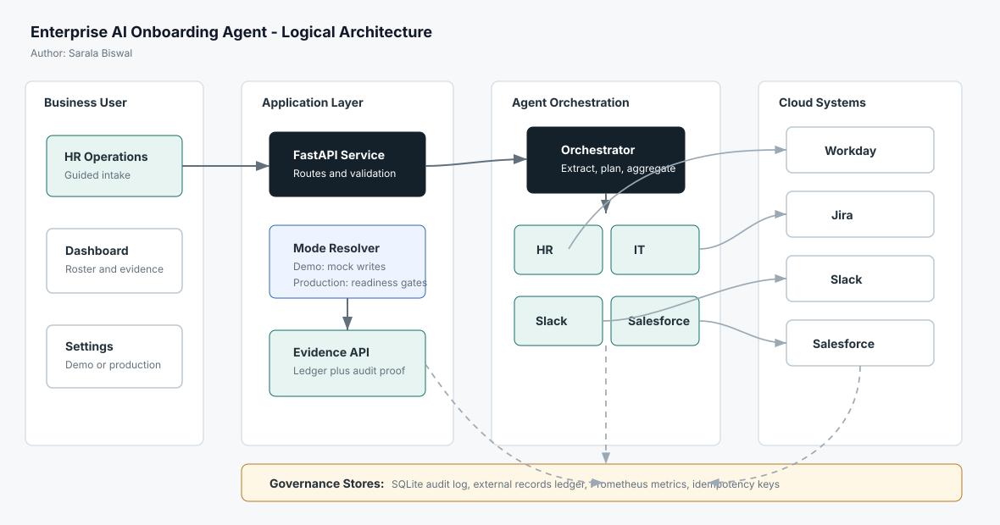

# Enterprise AI Onboarding Agent

**Author:** Sarala Biswal

Enterprise AI Onboarding Agent is a professional-grade pilot application that turns one HR onboarding request into coordinated actions across HR, IT, collaboration, and sales operations systems. It is designed to show how agentic orchestration can reduce manual handoffs while still giving business owners clear evidence of what was created, where it was stored, and which workflow produced it.



## Business Problem

Employee onboarding is usually spread across disconnected operating teams and cloud systems. HR creates the worker profile, IT opens access and hardware requests, managers need Slack updates, and sales-facing teams may require CRM readiness records. When these steps are handled manually, teams see repeated data entry, inconsistent timing, duplicate tickets, and weak audit evidence.

This app addresses that problem by giving HR operations a single command center for guided intake, workflow execution, mode-aware connector settings, and created-record evidence.

## How The App Addresses It

- Captures a new-hire request through a guided UI and generates a structured onboarding prompt.
- Extracts employee data into typed API models before workflow execution.
- Runs specialized agents for Workday, Jira, Slack, and Salesforce responsibilities.
- Uses MCP-style connector boundaries so mock, dry-run, and real connector behavior is explicit.
- Stores audit records and external record references in real SQLite tables.
- Shows business evidence cards with record IDs, connector mode, audit proof, idempotency guard, and stored URLs.
- Defaults to Demo Mode so the app is safe to run locally without writing to vendor systems.

## Core Capabilities

The command center includes:

- **Dashboard:** new-hire intake, workflow timeline, roster, system status, and evidence cards.
- **Governance:** audit log and operational metrics.
- **Settings:** clear Demo Mode and Production Mode selection with mode-specific settings.
- **Logical Architecture:** clean in-app diagrams showing prompt flow, mode resolution, orchestration, MCP boundaries, and governance.
- **Physical Architecture:** POC and production deployment views.

## Demo Mode vs Production Mode

The app defaults to Demo Mode:

```bash
APP_MODE=demo
WORKDAY_MODE=auto
IT_MODE=auto
SLACK_MODE=auto
SALESFORCE_MODE=auto
SLACK_MOCK_MODE=true
```

In Demo Mode, connector `auto` settings resolve to mock writes. The app still creates real local audit and ledger rows, which makes the demo repeatable and reviewable without calling external vendors.

Production Mode is selected in the Settings page or configured as:

```bash
APP_MODE=real
```

In Production Mode, connector `auto` settings resolve to real connectors. The app checks `/pilot/readiness` and blocks unsafe workflow runs when required credentials or endpoint settings are missing.

## Logical Architecture

The runtime flow is:

1. HR operations enters or loads a new-hire request in the browser UI.
2. FastAPI validates the request and resolves Demo Mode or Production Mode.
3. The orchestrator extracts structured employee data and runs specialized agents.
4. Agents call MCP connector boundaries for Workday, Jira, Slack, and Salesforce.
5. Connector responses are written into the external record ledger and audit log.
6. The UI renders business evidence from the workflow response, then upgrades it with persisted ledger and audit rows.

The SVG architecture diagram used above lives at [docs/architecture.svg](docs/architecture.svg).

## Data Storage

The pilot uses SQLite through `DB_PATH`, which defaults to `audit.db`.

- `audit_log` stores workflow-level action proof: workflow ID, agent, tool, masked input, output, duration, status, and timestamp.
- `external_records` stores created-record evidence: system, action, idempotency key, external ID, external URL, connector mode, status, and timestamp.

The ledger has a unique key on system, action, and idempotency key so retries and repeated sample loads do not create duplicate business artifacts for the same employee/system/action combination.

## Key Endpoints

- `GET /` serves the browser command center.
- `GET /health` returns service health.
- `POST /onboard` runs the multi-agent onboarding workflow.
- `POST /onboard/status` checks whether a new hire already has ledger-backed records.
- `POST /extract` extracts structured employee data from a prompt.
- `GET /workflows/{workflow_id}/evidence` returns ledger and audit evidence for one workflow.
- `GET /audit` returns audit log rows.
- `GET /metrics` returns Prometheus-compatible metrics.
- `GET /settings` returns safe runtime settings for the UI.
- `POST /settings/mode` switches Demo Mode or Production Mode at runtime.
- `GET /pilot/readiness` is included in settings output to show production connector readiness.

## Quick Start

### Prerequisites

- Python 3.11+
- Docker, optional

### Configure Environment

```bash
cp .env.example .env
```

Keep the default Demo Mode values for a safe local run.

### Run Locally

```bash
pip install -e ".[dev]"
uvicorn app.main:app --reload
```

Open:

```text
http://127.0.0.1:8000/
```

### Run With Docker Compose

```bash
docker compose up --build
```

## LLM Provider

The default provider is local Ollama:

```bash
LLM_PROVIDER=ollama
OLLAMA_BASE_URL=http://localhost:11434
OLLAMA_MODEL=llama3.1:8b
```

For deterministic local and CI behavior without an LLM call:

```bash
LLM_PROVIDER=rules
```

OpenAI and Anthropic can also be configured through `.env` if a pilot requires hosted model providers.

## Production Connector Configuration

Production Mode requires connector-specific configuration before real writes should be enabled:

```bash
APP_MODE=real

WORKDAY_MODE=real
WORKDAY_BASE_URL=https://example.workday.com
WORKDAY_TENANT=tenant-name
WORKDAY_ACCESS_TOKEN=...
WORKDAY_WORKERS_PATH=/ccx/api/v1/{tenant}/workers
WORKDAY_FIELD_MAP_JSON='{"full_name":"fullName","start_date":"startDate"}'

IT_MODE=real
JIRA_BASE_URL=https://example.atlassian.net
JIRA_EMAIL=automation@example.com
JIRA_API_TOKEN=...
JIRA_PROJECT_KEY=IT
JIRA_ISSUE_TYPE=Task

SLACK_MODE=real
SLACK_BOT_TOKEN=xoxb-...
SLACK_CHANNEL_MAP_JSON='{"john.doe":"U123456"}'

SALESFORCE_MODE=real
SALESFORCE_INSTANCE_URL=https://example.my.salesforce.com
SALESFORCE_ACCESS_TOKEN=...
SALESFORCE_READINESS_OBJECT=New_Hire__c
SALESFORCE_FIELD_MAP_JSON='{"employee_name":"Name","role":"Role__c"}'
```

## Testing

Run the backend and integration tests:

```bash
python3 -m pytest -q
```

Check the browser JavaScript syntax:

```bash
node --check app/static/app.js
```

## Git Readiness

This repository includes a `.gitignore` for Python caches, local virtual environments, generated coverage output, local `.env`, and SQLite runtime databases. Before checking in, review the changed files and avoid committing generated runtime artifacts.

Recommended check:

```bash
git status --short
```

If this directory is not yet a Git repository, initialize one before committing:

```bash
git init
git add .
git commit -m "Document onboarding agent pilot"
```

## Production Readiness Notes

For an enterprise rollout, add SSO and role-based access control at the API edge, move SQLite audit and ledger storage to a managed database, load secrets from an enterprise secrets manager, add tracing and alerting, and complete connector-specific security reviews before enabling production writes.
